# Causalytix · Project report diagram atlas

The immutable illustrations here document the system; each incident generates its own evidence-linked cause map and 5-Why chain.

[Notion edition](https://app.notion.com/p/CAUSALYTIX-Project-Report-Diagram-Atlas-41c3502181d78100893ddb122e49401a)

[Download all 11 figures as a printable PDF](../public/assets/causalytix-diagram-atlas.pdf). Each figure also has an SVG and Mermaid source under `public/assets/atlas/`.

## 01 / System context

The investigator supplies a brief and evidence, then reviews hypotheses before applying a fix.

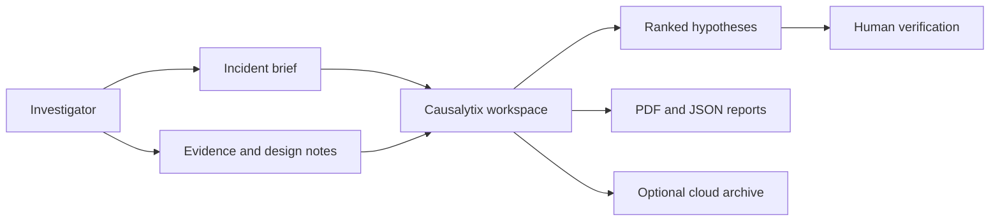

## 02 / Component architecture

The FastAPI gateway coordinates retrieval, inference and persistence; React renders the workspace.

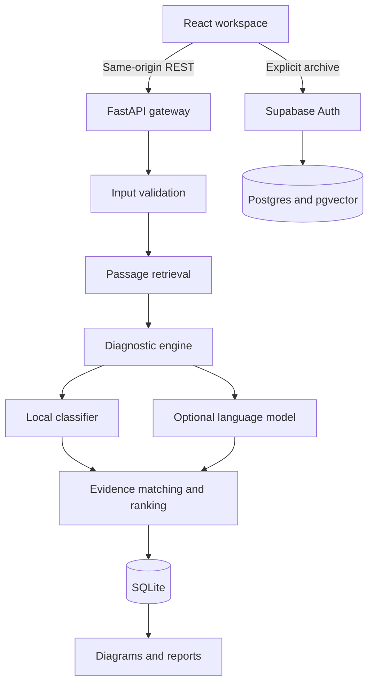

## 03 / Investigation workflow

The nine stages of a complete investigation, including the draft path and evidence-gap feedback loop.

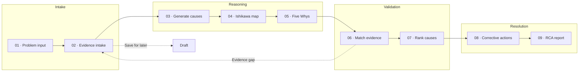

## 04 / Evidence data flow

A source reference records a document, passage number and original excerpt. Weak matches become explicit gaps.

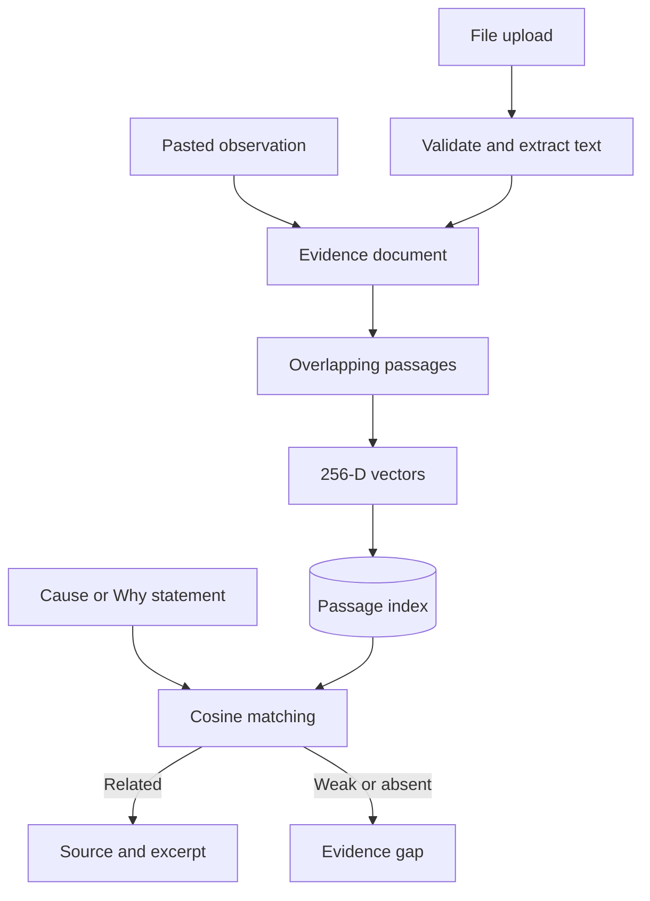

## 05 / Analysis sequence

Two model passes or the offline classifier produce candidates. The gateway computes scores independently.

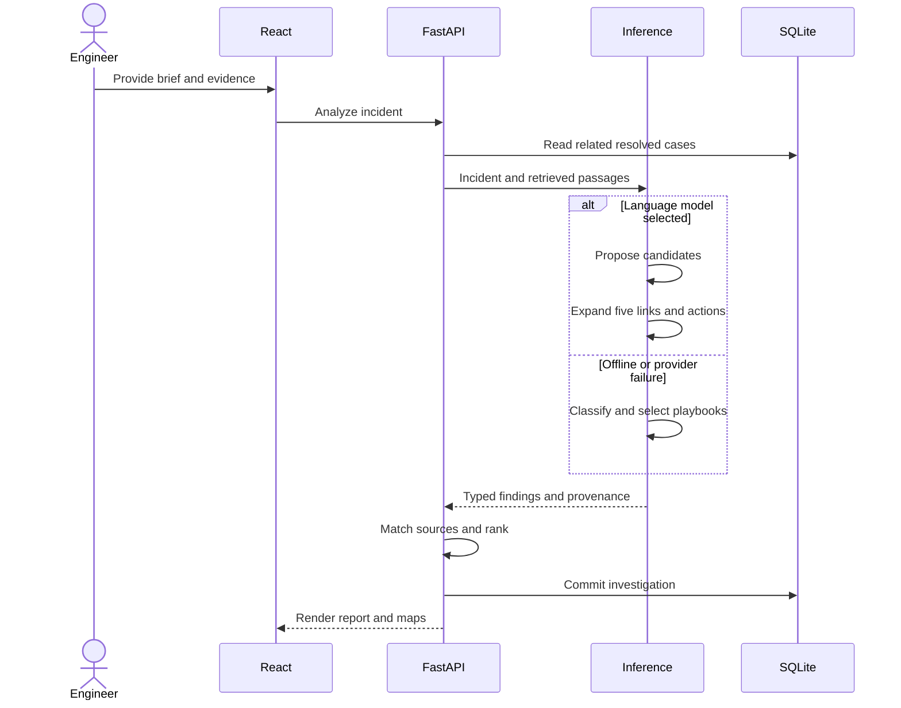

## 06 / Entity relationships

The same logical entities are kept locally and in Supabase. Cloud keys include the authenticated owner.

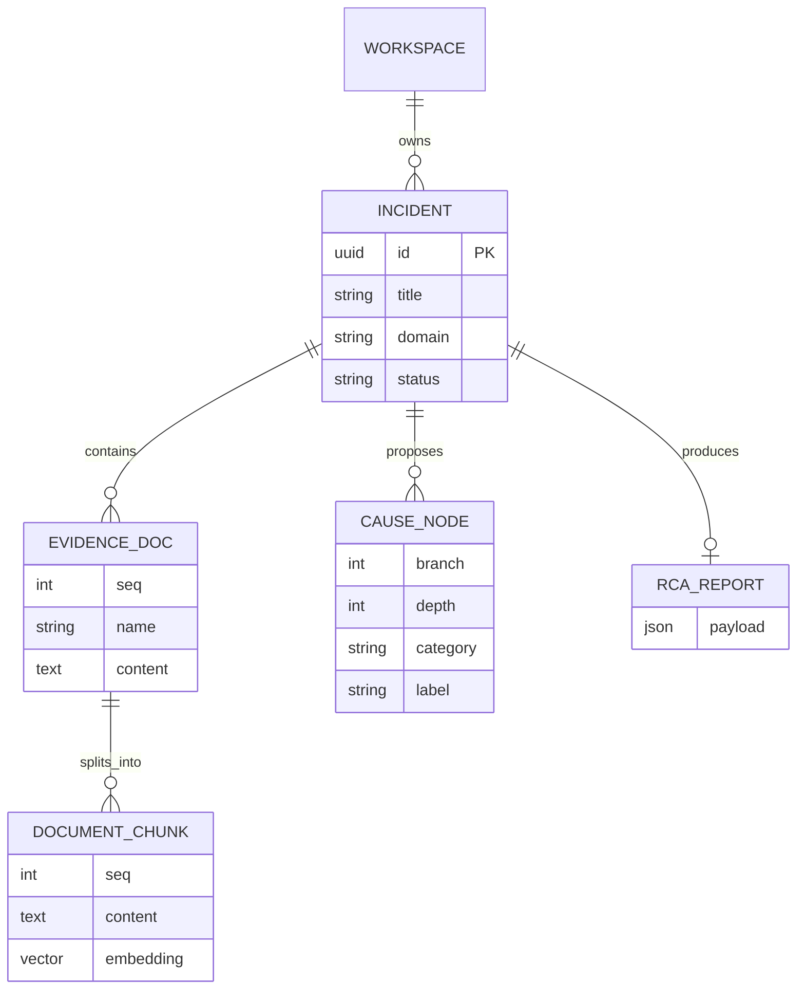

## 07 / Ishikawa mapping

Illustrative candidate branches, not confirmed causes. Each analyzed case has its own interactive fishbone.

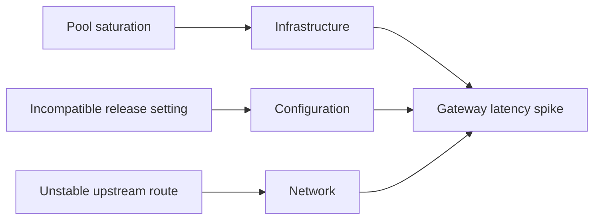

## 08 / 5-Why expansion

Each step is a testable hypothesis with its own related passage or evidence-gap flag.

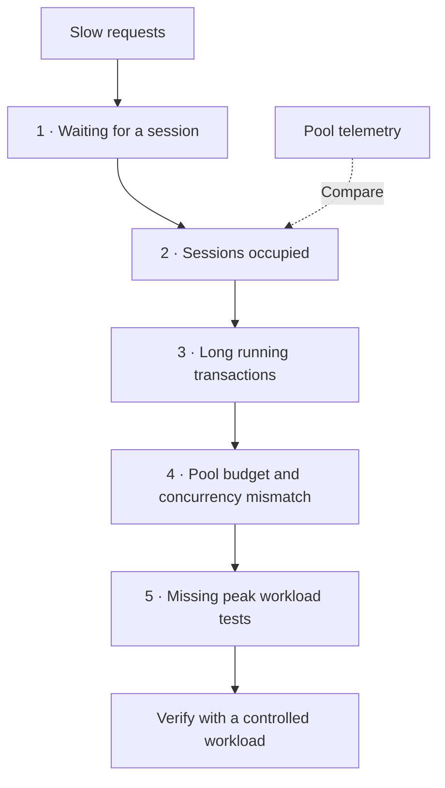

## 09 / Root cause ranking

The weighted sum ranks candidates, not the probability of a failure. A human verifies the proposed action.

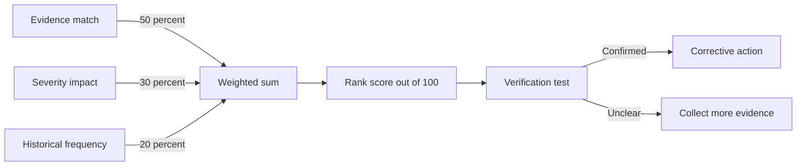

## 10 / Case lifecycle

Drafts can be analyzed, reviewed, resolved, and reopened without losing source evidence.

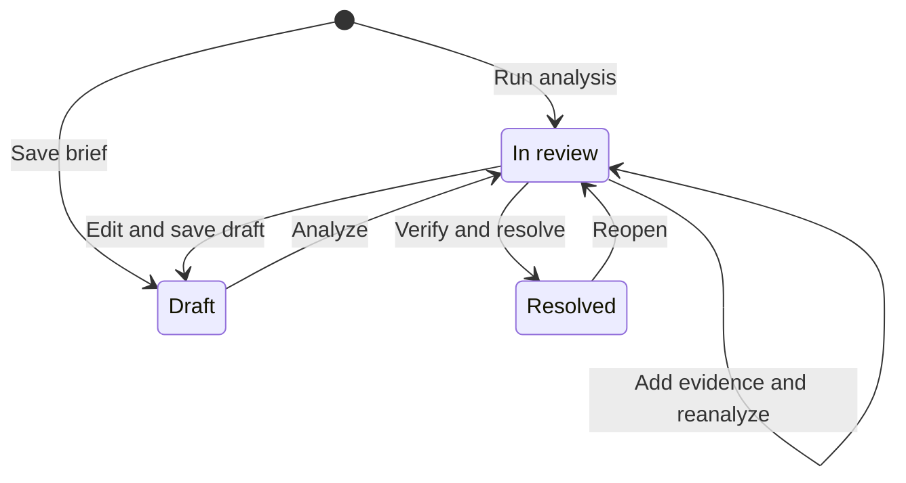

## 11 / Deployment boundaries

The local application runs without cloud credentials. Model inference and cloud archival are separate opt-in paths.

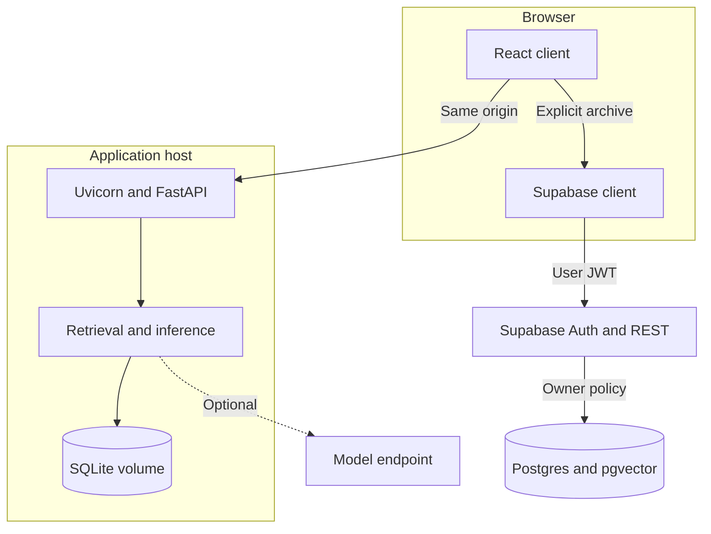
